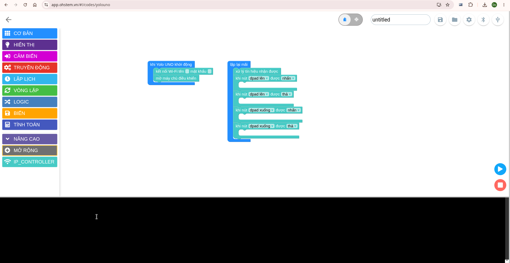

# IP controller

Điều khiển robot từ trình duyệt qua Wi-Fi. Trang điều khiển HTML gửi lệnh
HTTP tới robot; robot xử lý các lệnh trong khối `lặp vô hạn` của chương trình.

## Chuẩn bị

### 1. Tìm và tải mục mở rộng IP controller

Trong phần mở rộng của môi trường lập trình, tìm `IP controller` và tải mục
mở rộng này để sử dụng các khối lệnh điều khiển robot.

Các khối IP controller dùng để nhận và xử lý tín hiệu từ trang điều khiển:

### 2. Tải trang điều khiển HTML

Tải [fpv-ip_controller.html](./fpv-ip_controller.html) về máy tính hoặc điện
thoại dùng để điều khiển robot. Mở file này bằng trình duyệt web.

### 3. Chuẩn bị camera

Có thể dùng một trong hai cách phổ biến sau. Thiết bị camera và trang điều
khiển cần truy cập được trên cùng mạng Wi-Fi với thiết bị điều khiển.

#### Cách 1: ESP32-CAM

Thiết lập ESP32-CAM dùng IP tĩnh `192.168.1.49` và cổng `81`. Đây là giá trị
mặc định của camera trong trang điều khiển. Nếu đã cấu hình ESP32-CAM bằng địa
chỉ khác, nhấn vào IP camera ở đầu trang để nhập IP và cổng tương ứng.

#### Cách 2: Điện thoại Android

##### 3.1. Tải ứng dụng IP camera

Tải file [IP camera.apk](<./IP camera.apk>) về điện thoại Android.

##### 3.2. Cài đặt ứng dụng

Mở file APK trên điện thoại và làm theo hướng dẫn để cài đặt. Nếu Android yêu
cầu quyền cài ứng dụng từ nguồn này, cho phép trình cài đặt mà bạn đang dùng
thực hiện cài đặt.

##### 3.3. Chạy IP camera

Mở ứng dụng **IP camera** trên điện thoại và khởi động camera streaming. Đảm
bảo điện thoại và thiết bị điều khiển đang kết nối cùng mạng Wi-Fi. Sau khi
stream bắt đầu, ứng dụng sẽ cung cấp địa chỉ IP và cổng camera.

##### 3.4. Đổi IP và cổng camera

Trên trang điều khiển, nhấn vào địa chỉ camera ở đầu trang, nhập IP và cổng
đang hiển thị trong ứng dụng IP camera, sau đó lưu lại.

Mặc định camera là `192.168.1.49:81`; ứng dụng trên điện thoại có thể cấp địa
chỉ hoặc cổng khác, vì vậy hãy dùng đúng thông tin ứng dụng đang hiển thị.
